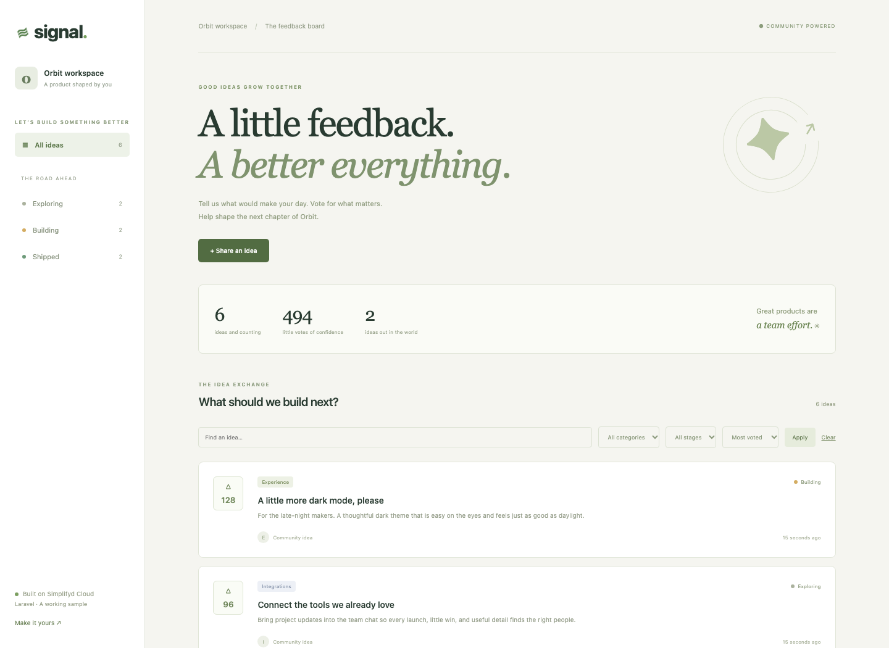

# Signal — Laravel community feedback board

[](https://console.cloud.simplifyd.com/deploy?repo=https%3A%2F%2Fgithub.com%2FSimplifydCloud%2Fsample-laravel-signal)

[](https://github.com/SimplifydCloud/sample-laravel-signal/actions/workflows/ci.yml)

Good ideas grow together. A working Laravel 13 app where visitors submit ideas, vote for favourites, explore a roadmap, and filter by category, stage, or popularity. Includes seeded demo ideas, validation, pagination, database-backed sessions, CSRF protection, rate limits, and a database readiness check.



## Try it locally

Requires **PHP 8.4+**, Composer 2, and PHP's SQLite, mbstring, DOM, and XML extensions. No Node build is needed: the UI uses Blade and plain CSS.

```sh
git clone https://github.com/SimplifydCloud/sample-laravel-signal.git
cd sample-laravel-signal
composer run setup
composer run dev
```

Open `http://localhost:8000`. Setup installs dependencies, creates `.env`, generates a private app key, creates a SQLite database, migrates, and seeds the board. The seeder is idempotent and preserves existing votes. Do not use `migrate:fresh` against a database you want to keep.

### Docker alternative

Only Docker is required. Generate a unique key and put it in your local `.env`:

```sh
cp .env.example .env
docker run --rm php:8.4-cli php -r 'echo "APP_KEY=base64:".base64_encode(random_bytes(32)).PHP_EOL;' >> .env
docker compose up --build
```

Open `http://localhost:8000`. Compose migrates and seeds automatically and saves SQLite data in the `signal-data` volume. This Compose configuration is for local testing. `docker compose down` stops the app and retains the volume.

## Deploy on Simplifyd Cloud

### Deploy with the button

Click **Deploy to Simplifyd Cloud** above, sign in, and choose a workspace and project. Review the web service (1 vCPU, 512 MB) and managed PostgreSQL database (1 vCPU, 1 GB RAM, 5 GB storage), then confirm. Deploy the database from the canvas before the web service. The web release migrates and seeds the board automatically, and each deployment receives its own app key and database credentials. These services incur normal Simplifyd usage charges.

The button uses the public, prebuilt `ghcr.io/simplifydcloud/sample-laravel-signal:1.0.0` image and the stack in `simplifyd.json`. Use the GitHub import flow below to build your own changes.

### Deploy your own source

1. Use **Use this template → Create a new repository** to make your own copy.
2. In your Simplifyd project, choose **Add → Deploy from GitHub**, connect GitHub, and grant the Simplifyd GitHub App access to your repository.
3. Choose the repository and `main` branch, with the app directory at the root. Simplifyd detects Laravel from `artisan`, `composer.json`, and the committed lockfile.
4. Select **PHP 8.4**, a managed **PostgreSQL** database, HTTP port **8080**, readiness path **`/ready`**, and enable **migrations**. Disable queue worker, scheduler, Redis, S3, and email for this sample.
5. Keep `APP_ENV=production`, `APP_DEBUG=false`, `SESSION_DRIVER=database`, `CACHE_STORE=database`, `QUEUE_CONNECTION=sync`, and `LOG_CHANNEL=stderr`. Set `APP_URL` to the app's public HTTPS URL. Simplifyd generates the app key and database variables; keep the generated `APP_KEY` stable between releases.
6. Choose **Build and deploy**. After the first successful release, open **Run Artisan** and run **`db:seed --force`** to add the demo ideas. The empty board also works before seeding.

Visit the app URL, submit an idea, and vote. Data lives in managed PostgreSQL and survives web releases. Database-backed sessions and cache support multiple web instances. GitHub pushes trigger new builds when managed builds are enabled.

The readiness endpoint checks both database connectivity and the `ideas` table. `/up` is Laravel's process health endpoint. Read release logs if migrations fail.

### Deploy an image instead

Build a versioned image for your target architecture and push it to your workspace registry:

```sh
docker buildx build --platform linux/amd64 --load -t signal:1.0.0 .
edge registry push signal:1.0.0
```

Choose **Add → Laravel App**, paste the image returned by Edge, and use the same database, port, readiness, and migration settings above. The image starts Apache and includes PHP and Artisan in `/var/www/html`. The GitHub managed build uses Simplifyd's build recipe; the included Dockerfile is for the image workflow.

## Tests

```sh
php artisan test
vendor/bin/pint --test
```

Tests cover idempotent seeding, submission and validation, protected status/vote fields, duplicate vote prevention, filtering, escaped user content, missing records, and readiness failures. CI runs on PHP 8.4 against SQLite and PostgreSQL and builds the production container.

## How it works

| Path | Purpose |
| --- | --- |
| `app/Http/Controllers/IdeaController.php` | Search, sorting, submission, and transactional voting |
| `app/Http/Requests/StoreIdeaRequest.php` | Input validation and allowed submission fields |
| `database/migrations/` | Schema, database sessions, cache, and unique vote receipts |
| `database/seeders/DatabaseSeeder.php` | Six fictional demo ideas with starting votes |
| `resources/views/board.blade.php` | Responsive, JavaScript-free UI |
| `public/signal.css` | Visual design |

Voting is anonymous and limited to one vote per idea per browser session. Clearing cookies creates a new identity; use authentication and moderation before turning this into a real public feedback product. Roadmap status is maintained through application code or your own admin tooling. The sample has no public admin endpoint.

[More Simplifyd samples](https://github.com/SimplifydCloud/sample-projects) · [Laravel deployment documentation](https://laravel.com/docs/13.x/deployment) · MIT licensed. Laravel skeleton portions retain their original license attribution.

## Maintaining the deploy image

The **Publish deploy image** GitHub Actions workflow publishes a Linux AMD64 image on a `v*` tag or a manual run with a version. For a new release, run the app checks, publish the new version, then update the image tag in `simplifyd.json`. A newly created GHCR package must be made public in its package settings before the button can pull it anonymously. Forks can publish images to their own namespace and update the manifest accordingly.
